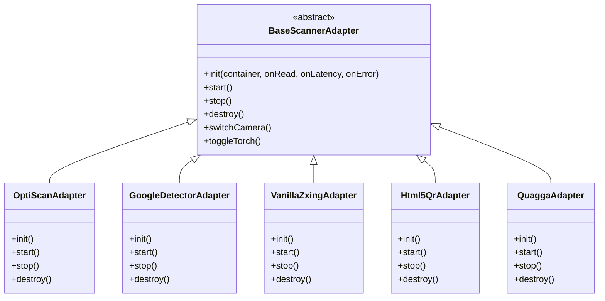

# 🏗️ Arquitetura de Software & Paridade de Testes — OptiScan Showcase

Este documento descreve as decisões de arquitetura de software, padrões de projeto e o rigor metodológico adotados na construção deste laboratório de testes e telemetria.

---

## 📐 Padrões de Projeto & Princípios SOLID

A aplicação foi desenvolvida sob o padrão arquitetural **Strategy / Adapter Pattern (GoF)** em **ES Modules (ESM)** nativos, garantindo clareza, desacoplamento e manutenibilidade de nível enterprise.



---

## 🔬 Paridade Científica e Visual dos Testes (Test Parity)

Para garantir que o comparativo de performance e assertividade seja 100% justo, imparcial e auditável por recrutadores e engenheiros de visão computacional, todos os 5 motores competem sob **idênticas condições operacionais e visuais**:

1. **ROI Verde e Framing Unificado:** A região de interesse (ROI demarcado por cantoneiras verdes neon e laser de varredura animado) é um componente compartilhado no DOM (`#standard-viewfinder`). Ele permanece ativo e com as mesmas dimensões (72% × 48%) sobreposto à câmera em **todos os 5 motores**, garantindo que nenhum motor receba vantagens de enquadramento.
2. **Mesma Resolução de Captura:** Todos os motores solicitam constraints de vídeo idênticas (`ideal: 1280x720, min: 640x480` a 60 FPS com sensor traseiro `environment`).
3. **Mesma Iluminação e Ângulo:** A comutação de motores é instantânea dentro da mesma sessão e pelo mesmo dispositivo físico (ex: Samsung Galaxy M53 ou Desktop).
4. **Mapeamento Unificado de Eventos:**
   - **`onRead(code, isConsensus)`:** Disparado no exato instante em que um código é decodificado.
   - **`onLatency(latencyMs)`:** Mede o tempo de processamento em JavaScript/WASM de cada frame.
   - **`onError(err)`:** Captura exceções de decodificação e driver de câmera.

---

## 🔌 Especificações Técnicas dos Adaptadores (Adapter Layer)

Cada biblioteca concorrente possui peculiaridades de API e gerenciamento de hardware. A camada de adaptadores padroniza essas interfaces mantendo as chamadas no mesmo nível de justiça:

### 1. OptiScan SDK (C++ WebAssembly Core)
- **Engine:** Binário WebAssembly compilado com Clang/Emscripten (`-O3`, SIMD).
- **Entrada:** Processamento de stream direto da câmera integrado à Heurística Proprietária de Integridade de Sinal.
- **Isolamento:** Overlays internos de CSS da biblioteca foram neutralizados em favor do Viewfinder padronizado do laboratório.

### 2. Google BarcodeDetector API (Chromium Nativo)
- **Engine:** API nativa do navegador Chromium (aceleração de hardware pelo SO).
- **Entrada:** Recebe o elemento `<video>` nativo e roda a detecção com formatos `['ean_13', 'ean_8', 'upc_a', 'upc_e', 'code_128']`.
- **Particularidade:** Altíssimo throughput quando o código está perfeitamente plano, porém sofre quedas de assertividade em curvaturas severas.

### 3. Vanilla ZXing-JS (`@zxing/library`)
- **Engine:** `MultiFormatReader` em JavaScript puro rodando em pipeline de binarização direta (`RGBLuminanceSource` + `HybridBinarizer`).
- **Particularidade & Ajuste:** O leitor clássico de 1D do ZXing varre linhas exclusivamente no eixo horizontal (x). Quando uma embalagem é segurada verticalmente (como a lateral de caixas de gelatina, cosméticos e remédios, onde as barras ficam horizontais), a varredura convencional corre paralela às barras e nunca cruza o código. O adaptador implementa **análise de orientação de duplo eixo (0° e 90°)** em cada frame, além de desviar dos deadlocks de promessa comuns na classe `BrowserMultiFormatReader` em navegadores mobile.
- **Teardown:** `multiFormatReader.reset()` garante a liberação de memória e encerramento do ciclo.

### 4. HTML5-QRCode (`html5-qrcode@2.3.8`)
- **Engine:** Wrapper de alto nível com fallback para ZXing e BarcodeDetector.
- **Particularidade & Ajuste:** A versão 2.3.8 do HTML5-QRCode valida estritamente o parâmetro de câmera `cameraIdOrConfig`. Passar objetos fora do padrão lança exceção imediata. Foi fixada a constraint padrão `{ facingMode: 'environment' }` e garantida a liberação prévia do stream nativo (`cameraManager.stopStream()`) para evitar `NotReadableError` decorrente de concorrência com o driver do Android/Samsung.

### 5. Quagga2 (`@ericblade/quagga2`)
- **Engine:** Leitor 1D baseado em processamento de canvas e gradiente de bordas.
- **Particularidade & Ajuste:** Configurado para `readers: ['ean_reader', 'upc_reader']`. Opera em resolução moderada (640x480) para equilibrar o alto consumo de CPU em navegadores móveis.

---

## 📁 Estrutura Modular de Arquivos

```text
optiscan-sdk-showcase/
├── index.html                   # Shell SPA responsivo (Desktop & Mobile M53)
├── style.css                    # Estilização obsidian glassmorphism + Breakpoints
├── docs/
│   └── ARCHITECTURE.md          # Esta documentação arquitetural
├── js/
│   ├── main.js                  # Entry point e orquestrador da aplicação
│   ├── config/
│   │   └── constants.js         # Configurações globais, motores e condições
│   ├── core/
│   │   ├── audio.js             # Sintetizador de áudio Web Audio API (Bip com zero latência)
│   │   ├── camera.js            # Gerenciador resiliente de captura e enumeração de câmeras
│   │   └── telemetry.js         # Monitor de FPS real e latência por frame
│   ├── benchmark/
│   │   ├── ground-truth.js      # Validador de código de controle, checksum e alucinações
│   │   ├── series-manager.js    # Gerenciador da bateria (até 10 eventos) e matriz consolidada
│   │   └── exporter.js          # Exportador profissional de dados (CSV, Markdown, JSON)
│   ├── engines/
│   │   ├── engine-adapter.js    # Interface Base abstrata (BaseScannerAdapter)
│   │   ├── optiscan-adapter.js  # Adaptador do OptiScan SDK (C++ WebAssembly Core)
│   │   ├── google-adapter.js    # Adaptador da BarcodeDetector API (Chromium Nativo)
│   │   ├── zxing-adapter.js     # Adaptador do Vanilla ZXing-JS (Com hints 1D e decodeFromStream)
│   │   ├── html5qr-adapter.js   # Adaptador do HTML5-QRCode (Sintaxe estrita de câmera)
│   │   └── quagga-adapter.js    # Adaptador do Quagga2
│   └── ui/
│       ├── ui-controller.js     # Gestão da interface, tabs, toasts e glitch
│       └── trigger-controller.js# Controle do gatilho de disparo único e atalho de espaço
└── sdk/
    ├── OptiScanScanner.wasm     # Binário WebAssembly otimizado (-O3, sem debug)
    ├── OptiScanScanner.js       # Glue code Emscripten
    ├── optiscan-sdk.min.js      # Wrapper JS ofuscado via Terser com Trava de Domínio
    └── optiscan-sdk.css         # Estilos isolados do componente do scanner
```

---

## 🎯 Como o OptiScan Vence em Superfícies Desafiadoras

Enquanto motores convencionais realizam **decodificação ingênua frame-a-frame** (onde uma dobra, curvatura acentuada ou reflexo especular cega a imagem e gera alucinações de leitura), o **OptiScan** aplica uma arquitetura de alta performance:

1. **Núcleo C++ compilado para WebAssembly (`-O3`):** Processamento matemático de imagem em tempo real a 60 FPS com latência sub-15ms e sem pausas de Garbage Collector.
2. **Heurística Proprietária de Validação e Integridade de Sinal (*Signal Integrity Engine*):** Filtros estatísticos e heurísticas proprietárias que blindam o scanner contra leituras truncadas e falsos positivos, garantindo integridade de sinal em embalagens de alta complexidade física.
