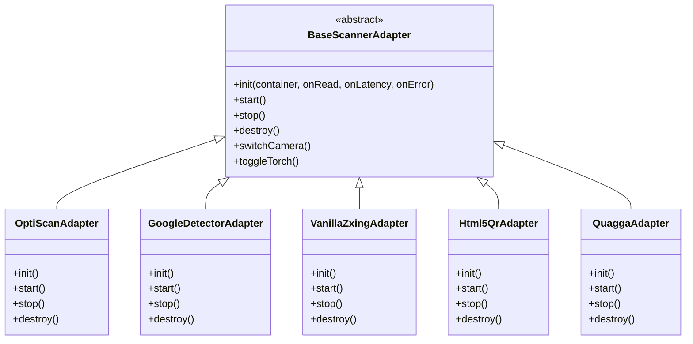

# 🏗️ Arquitetura de Software & Paridade de Testes — OptiScan Showcase

Este documento descreve as decisões de arquitetura de software, padrões de projeto e o rigor metodológico adotados na construção deste laboratório de testes e telemetria.

---

## 📐 Padrões de Projeto & Princípios SOLID

A aplicação foi desenvolvida sob o padrão arquitetural **Strategy / Adapter Pattern (GoF)** em **ES Modules (ESM)** nativos, garantindo clareza, manutenibilidade e escalabilidade enterprise.



---

## 🔬 Paridade Científica dos Testes

Para garantir que o comparativo de performance e assertividade seja 100% justo e auditável por recrutadores e engenheiros de visão computacional, todos os 5 motores competem sob **idênticas condições operacionais**:

1. **Mesma Resolução de Captura:** Todos os motores solicitam constraints de vídeo idênticas (`ideal: 1280x720, min: 640x480` a 60 FPS com sensor `environment`).
2. **Mesma Iluminação e Ângulo:** A comutação de motores é instantânea dentro da mesma sessão e pelo mesmo dispositivo físico.
3. **Mapeamento Unificado de Eventos:**
   - **`onRead(code, isConsensus)`:** Disparado no exato instante em que um código é decodificado.
   - **`onLatency(latencyMs)`:** Mede o tempo de processamento em JavaScript/WASM de cada frame.
   - **`onError(err)`:** Captura exceções de decodificação e driver de câmera.

---

## 📁 Estrutura Modular de Arquivos

```text
optiscan-sdk-showcase/
├── index.html                   # Shell SPA responsivo (Desktop & Mobile M53)
├── style.css                    # Estilização obsidian glassmorphism + Breakpoints
├── js/
│   ├── main.js                  # Entry point e orquestrador da aplicação
│   ├── config/
│   │   └── constants.js         # Configurações globais, motores e condições
│   ├── core/
│   │   ├── audio.js             # Sintetizador de áudio Web Audio API (Bip com zero latência)
│   │   ├── camera.js            # Gerenciador resiliente de captura e enumeração de câmeras
│   │   └── telemetry.js         # Monitor de FPS real e latência por frame
│   ├── benchmark/
│   │   ├── ground-truth.js      # Validador de código de controle, checksum e alucinações
│   │   ├── series-manager.js    # Gerenciador da bateria (até 10 eventos) e matriz consolidada
│   │   └── exporter.js          # Exportador profissional de dados (CSV, Markdown, JSON)
│   ├── engines/
│   │   ├── engine-adapter.js    # Interface Base abstrata (BaseScannerAdapter)
│   │   ├── optiscan-adapter.js  # Adaptador do OptiScan SDK (C++ WebAssembly Core)
│   │   ├── google-adapter.js    # Adaptador da BarcodeDetector API (Chromium Nativo)
│   │   ├── zxing-adapter.js     # Adaptador do Vanilla ZXing-JS
│   │   ├── html5qr-adapter.js   # Adaptador do HTML5-QRCode
│   │   └── quagga-adapter.js    # Adaptador do Quagga2
│   └── ui/
│       ├── ui-controller.js     # Gestão da interface, tabs, toasts e glitch
│       └── trigger-controller.js# Controle do gatilho de disparo único e atalho de espaço
├── sdk/
│   ├── OptiScanScanner.wasm     # Binário WebAssembly otimizado (-O3, sem debug)
│   ├── OptiScanScanner.js       # Glue code Emscripten
│   ├── optiscan-sdk.min.js      # Wrapper JS ofuscado via Terser com Trava de Domínio
│   └── optiscan-sdk.css         # Estilos isolados do componente do scanner
└── docs/
    └── ARCHITECTURE.md          # Esta documentação arquitetural
```

---

## 🎯 Como o OptiScan Vence em Superfícies Desafiadoras

Enquanto os concorrentes realizam **análise de frame estático** (onde uma dobra ou reflexo cega o código inteiro na imagem), o **OptiScan** aplica uma arquitetura de dois pilares:

1. **Fatiamento Espacial (*Spatial Slicing*):** O frame de vídeo é seccionado em fatias horizontais independentes dentro do WebAssembly. Mesmo que a embalagem esteja severamente amassada ou curva, partes das barras permanecem alinhadas em fatias individuais.
2. **Consenso Temporal (*Temporal Consensus*):** À medida que o operador movimenta a embalagem na frente da câmera, a luz especular e os reflexos se deslocam. O OptiScan acumula os votos de múltiplos frames consecutivos para reconstruir o código com 100% de integridade, eliminando alucinações de leitura.
